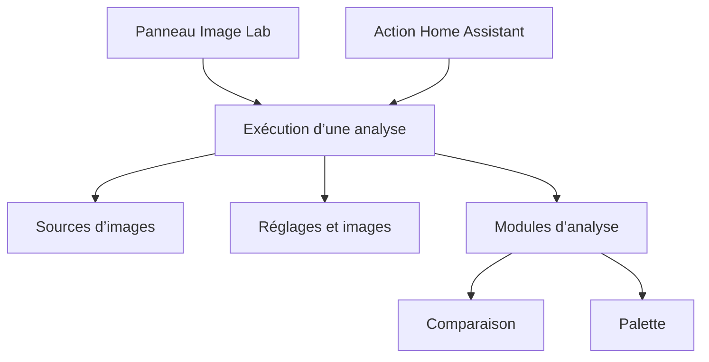

# Image Lab pour Home Assistant

Image Lab est un projet d’intégration Home Assistant pour analyser localement des images. Une **analyse** associe une source, un type de traitement et des réglages. Elle se configure dans un panneau Home Assistant et peut être lancée à la demande dans une automatisation.

La version de développement permet de comparer des images et de tester la source du module de palette. L’extraction des couleurs arrive à l’étape 3.

## Installation de développement

1. Avec Home Assistant **2026.10.4 ou ultérieur**, ouvrir **HACS → Dépôts personnalisés** et ajouter `https://github.com/zoic21/ha-imagelab` dans la catégorie **Intégration**. Télécharger la branche de développement et redémarrer Home Assistant.
2. Dans **Paramètres → Appareils et services → Ajouter une intégration**, chercher **Image Lab**. Saisir le nom et choisir le module puis la source. Pour une image importée, sélectionner un JPEG, PNG ou WebP fixe de 10 Mio et 24 mégapixels maximum.
3. Ouvrir **Image Lab** dans la barre latérale et sélectionner l’analyse. Le panneau permet également d’ajouter d’autres analyses et de les reconfigurer dans les réglages natifs de l’intégration.

Le panneau et les appels manuels à l’action sont réservés aux administrateurs. Les captures et pochettes sont récupérées à chaque test. L’original d’une image importée est conservé dans le répertoire de configuration et supprimé avec l’analyse.

Les validations HACS et hassfest tournent sur GitHub Actions à chaque modification de `main` et sur les pull requests.

## Première version

| Outil | Ce qu’on configure | Ce que l’analyse renvoie |
| --- | --- | --- |
| **Comparaison d’images** | Une source, une zone facultative, des états nommés et plusieurs images de référence par état | L’état reconnu ou `unknown`, les distances par état et la référence la plus proche |
| **Extraction de palette** | Une source et le nombre de couleurs demandé | Une couleur dominante et la palette RGB, utilisables dans une automatisation |

Exemples d’usage :

- Déterminer si un volet de piscine est ouvert, fermé ou intermédiaire à partir d’une capture caméra. Les références prises de jour et de nuit peuvent appartenir au même état.
- Extraire les couleurs de la pochette d’un lecteur multimédia et transmettre la palette à l’automatisation qui pilote les lumières.

Les sources disponibles sont une **capture de caméra Home Assistant**, la **pochette d’un lecteur multimédia** ou une **image importée**. Le panneau propose les sources que l’outil sélectionné sait utiliser.

## Interface

Sur tablette en paysage et sur ordinateur, le panneau affiche la liste et le détail côte à côte. Sur mobile, le détail s’ouvre sur toute la largeur. La création et la reconfiguration des analyses utilisent les formulaires et sélecteurs natifs de Home Assistant.

### Comparer des images

1. Dans **Références**, créer un état par situation à reconnaître. Importer plusieurs images à la fois dans **Images de référence**. Garder d’autres captures dans **Images de validation**, avec leur état attendu. Le bouton **Évaluer** rejoue ces captures sans les utiliser comme références.
2. Dans **Aperçu**, sélectionner **Tester la source**. Choisir **Tracer la zone** pour cadrer à la souris ou au doigt. Le panneau montre l’état proposé, les distances par état et la référence la plus proche. **Classer la capture** ajoute l’image testée à l’état et au groupe choisis.
3. Dans **Réglages**, ajuster la distance maximale (25 par défaut) et l’écart minimal (3 par défaut) sur une échelle de 0 à 255. La zone peut aussi être saisie en pourcentages. Les tests peuvent utiliser les réglages en cours d’édition. L’action utilise les réglages enregistrés.

Pour migrer les références Pyscript, choisir **Importer les dossiers par état** dans un navigateur qui prend en charge la sélection de dossiers. Sélectionner le dossier `references` qui contient un sous-dossier par état. Les images sont importées comme références et les états correspondants sont créés. Les originaux sont conservés dans la configuration Home Assistant. Le cadrage s’applique à chaque image lors du calcul.


## Architecture



Une intégration `custom_components/image_lab` regroupe le backend Python et le panneau TypeScript. Chaque analyse dispose d’un identifiant stable et d’une entrée de configuration Home Assistant avec sa source et ses options. Renommer l’analyse conserve son identifiant. Le panneau est enregistré une seule fois pour l’intégration.

| Partie | Responsabilité |
| --- | --- |
| **Sources** | Récupérer des octets d’image depuis une entité `camera`, un lecteur multimédia ou une image importée. Le module reçoit l’image et les informations nécessaires au cadrage. |
| **Exécution** | Charger les options, récupérer la source, appeler le module et formater sa réponse. Le traitement d’image s’exécute hors de la boucle principale de Home Assistant. |
| **Stockage** | Conserver les images originales et leurs métadonnées par analyse. Les coordonnées de la zone sont relatives à l’image pour supporter les changements de résolution. Versionner les données et permettre aux sauvegardes Home Assistant de reprendre les références. |
| **Modules** | Déclarer les sources prises en charge, le schéma des réglages et le format du résultat. Chaque module possède son moteur et son affichage spécifique. Le registre des modules est explicite dans le code. |
| **Panneau** | Lister les analyses, éditer la zone et gérer les références. Les commandes de configuration et de test passent par le backend Home Assistant. |

Le moteur de **comparaison** reprend le Pyscript. Il recadre, redimensionne, passe en niveaux de gris et applique un flou avant de mesurer la moyenne des écarts absolus entre les pixels. Il expose la distance au meilleur état et l’écart avec le suivant. Les seuils se règlent sur des captures représentatives, en gardant des images de test hors des références. Les images originales sont conservées pour pouvoir recadrer les références après coup.

Le premier moteur de **palette** reprend l’extraction existante pour les pochettes et conserve un résultat `palette_rgb` de taille prévisible. Le nombre de couleurs distinctes peut être inférieur à la longueur demandée. La taille par défaut est de cinq entrées pour les automatisations existantes. Les couleurs disponibles sont réutilisées si nécessaire.

## Actions et résultats

L’action `image_lab.analyze` et le bouton **Tester la source** utilisent le même moteur. Le panneau fournit l’identifiant de l’analyse à copier dans l’automatisation. [Actions avec données de réponse](https://contributors.home-assistant.io/core/integrations/actions/#return-response-data)

Ce bloc utilise un identifiant d’exemple.

```yaml
action: image_lab.analyze
data:
  profile_id: "01jfxc7wcj5d1wzqjpgzrw2mgp"
response_variable: analysis
```

La réponse contient un `status` commun et un objet `data` propre au module. La comparaison renvoie `data.state`, `data.scores`, `data.ref_counts`, la meilleure distance, l’écart et l’identifiant de la référence la plus proche. Une distance trop élevée ou un écart insuffisant donnent `status: unknown` et `data.state: unknown`. Une source indisponible donne `status: error`. Le champ `reason` précise la cause. Le module de palette renvoie encore les métadonnées de source en mode `source_check`.

La migration des Pyscripts se teste d’abord sur les mêmes images et les mêmes automatisations. Pour la comparaison, l’import doit reprendre les références déjà rangées par état. Pour la palette, le format RGB et les cinq entrées utilisées dans les automatismes d’éclairage servent de test de compatibilité.

## Plan de réalisation

| Étape | Travail | Critère de validation |
| --- | --- | --- |
| **1. Intégration et panneau** | Ajouter la création d’analyses, le stockage, les sources d’image, le registre de modules et l’action. Réutiliser le thème et les formulaires natifs. | Créer une analyse depuis Home Assistant, la retrouver après redémarrage et récupérer la même source depuis le panneau et l’action. |
| **2. Comparaison** | Porter le comparateur Pyscript. Ajouter le cadrage tactile, la galerie par état, l’import multiple, le reclassement et les deux seuils. | Rejouer des captures de jour et de nuit avec des images gardées pour le test. Vérifier au moins trois états, un cas ambigu et une caméra indisponible. |
| **3. Palette** | Porter l’extraction couleur. Afficher l’aperçu des couleurs et exposer le résultat RGB aux automatisations. | Récupérer les palettes de deux lecteurs, vérifier le comportement en l’absence de pochette et rejouer une automatisation existante à cinq couleurs. |
| **4. Première version installable** | Vérifier l’installation via HACS sur une instance Home Assistant OS, l’éditeur tactile, les sauvegardes et la restauration. | Réussir une installation propre et une mise à jour avec conservation des analyses et références. Documenter le premier parcours complet. |

La version de développement requiert **Home Assistant Core 2026.10.4** ou ultérieur. La première installation sur **Home Assistant OS x86‑64** est prévue à l’étape 4. [Structure d’une intégration HACS](https://hacs.dev/docs/publish/integration/)

## Évolutions possibles

| Évolution | Approche |
| --- | --- |
| **Détection d’objets sur image fixe** | Ajouter un module qui analyse un JPEG à la demande, filtre les catégories et les scores, puis renvoie la présence, le nombre et les rectangles des objets. Premier candidat : NanoDet-Plus 416 × 416 avec `ncnn`, Pillow et NumPy. |
| **Lecture de compteurs mécaniques** | Évaluer `tarsius` pour lire les rouleaux et aiguilles. L’éditeur définit les zones et la rotation. Le module conserve la dernière lecture acceptée et contrôle la cohérence des nouvelles valeurs avant de publier un capteur Énergie. Un test de réglage ne valide pas une nouvelle valeur. |
| **Reconnaissance d’un objet précis** | Recadrer l’objet détecté, puis comparer ce recadrage à plusieurs exemples annotés sous des angles différents. Évaluer les faux positifs sur des objets similaires et prévoir une identité inconnue. |
| **Comparaison plus robuste** | Évaluer un moteur à descripteurs, par exemple Tarsius, sur les mêmes images de validation que le calcul actuel. Comparer séparément le jour, la nuit et les scènes ambiguës avant de choisir un moteur par défaut. |
| **Capteurs et nouveaux outils** | Ajouter la publication facultative du dernier résultat et envisager des outils comme la présence d’une couleur dans une zone ou l’OCR d’un affichage. Chaque outil réutilise la capture, les réglages communs et l’action. |

### Validation déjà réalisée pour la détection

Un prototype NanoDet-Plus 416 × 416 a fonctionné dans l’image officielle de **Core 2026.10.4 x86‑64**, sur CPU, avec `ncnn` et sans OpenCV. Le modèle converti pèse **2,42 Mo**. Une action Home Assistant a récupéré un JPEG via une caméra alimentée par un fichier de test et renvoyé les détections. Sur un AMD EPYC, la médiane de 30 analyses était de **26,5 ms** sur un thread, décodage et traitement des résultats compris.

Avant d’intégrer ce module, mesurer la latence sur un Intel N100 et vérifier la détection sur de vraies captures de caméra, de jour et de nuit. Vérifier également les conditions de redistribution des poids retenus et choisir leur mode de distribution. [NanoDet-Plus](https://github.com/RangiLyu/nanodet) · [Paquet Python ncnn](https://pypi.org/project/ncnn/) · [Tarsius](https://github.com/RaHehl/tarsius)

## Développer le panneau

Le navigateur charge le module compilé livré avec l’intégration. Après avoir modifié les sources TypeScript dans `frontend`, reconstruire le fichier JavaScript avec la commande suivante.

```sh
npx --yes --package typescript@6.0.3 tsc -p frontend
```
