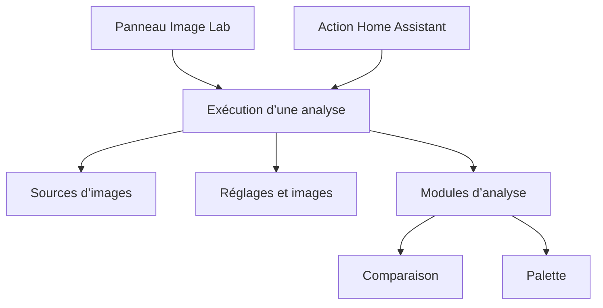

# Image Lab pour Home Assistant

Image Lab est un projet d’intégration Home Assistant pour analyser localement des images. Une **analyse** associe une source, un type de traitement et des réglages. Elle se configure dans un panneau Home Assistant et peut être lancée à la demande dans une automatisation.

Le dépôt contient le socle de l’intégration et sa feuille de route. Le panneau et les outils d’analyse décrits ci-dessous sont prévus pour la première version fonctionnelle.

## Installation de développement

Dans HACS, ouvrir **Dépôts personnalisés**, ajouter `https://github.com/zoic21/ha-imagelab` dans la catégorie **Intégration**, puis télécharger **Image Lab** depuis la branche `main` et redémarrer Home Assistant. Cette installation permet de vérifier la distribution du socle. L’ajout d’analyses dans Home Assistant arrivera avec le parcours de configuration.

Les validations HACS et hassfest tournent sur GitHub Actions à chaque modification de `main` et sur les pull requests.

## Première version

| Outil | Ce qu’on configure | Ce que l’analyse renvoie |
| --- | --- | --- |
| **Comparaison d’images** | Une source, une zone facultative, des états nommés et plusieurs images de référence par état | L’état reconnu ou `unknown`, les distances par état et la référence la plus proche |
| **Extraction de palette** | Une source et le nombre de couleurs demandé | Une couleur dominante et la palette RGB, utilisables dans une automatisation |

Exemples d’usage :

- Déterminer si un volet de piscine est ouvert, fermé ou intermédiaire à partir d’une capture caméra. Les références prises de jour et de nuit peuvent appartenir au même état.
- Extraire les couleurs de la pochette d’un lecteur multimédia et transmettre la palette à l’automatisation qui pilote les lumières.

Les sources prévues sont une **capture de caméra Home Assistant**, la **pochette d’un lecteur multimédia** ou une **image importée**. Le panneau propose les sources que l’outil sélectionné sait utiliser.

## Interface

Image Lab apparaît dans la barre latérale de Home Assistant. Sur tablette en paysage et sur ordinateur, la liste des analyses est à gauche et le détail à droite. Sur mobile, le détail s’ouvre sur toute la largeur.

- **Aperçu** affiche l’image, la zone analysée et le dernier résultat du test. Le bouton **Tester** lance l’analyse. Pour une comparaison, on voit les distances par état, la référence la plus proche et la raison d’un résultat indéterminé.
- **Références** permet de créer et renommer les états, de capturer ou importer plusieurs images et de les reclasser. Le bouton **Classer la capture** permet d’ajouter l’image testée à l’état choisi. Le panneau distingue les références utilisées par le moteur des images gardées pour évaluer ses résultats.
- **Réglages** permet de choisir la source et de modifier les options du module. En comparaison, la **distance maximale** rejette une image trop éloignée des références. L’**écart minimal** rejette une décision ambiguë entre les deux meilleurs états.

**Réutiliser Home Assistant au maximum.** Le panneau reprend le thème et les variables de Home Assistant. Les cartes s’appuient sur `ha-card`. Les formulaires de création et de réglage utilisent les parcours de configuration Home Assistant et leurs sélecteurs natifs pour les entités, les listes et les nombres. Les composants internes `ha-*` peuvent changer ou être chargés à la demande. Limiter leur usage direct dans le panneau aux composants vérifiés sur les versions prises en charge. [Panneaux personnalisés](https://contributors.home-assistant.io/frontend/custom-ui/panel/) · [Sélecteurs](https://www.home-assistant.io/docs/blueprint/selectors/) · [Compatibilité des composants du frontend](https://contributors.home-assistant.io/frontend/custom-ui/)

L’éditeur d’image est commun aux modules. Il gère le tracé à la souris et au doigt, l’affichage des zones et, plus tard, les rectangles de détection et les repères de compteur. La galerie de références utilise ces mêmes aperçus.

## Architecture



Une intégration `custom_components/image_lab` regroupe le backend Python et le panneau TypeScript. Chaque analyse dispose d’un identifiant stable et d’une entrée de configuration Home Assistant avec sa source et ses options. Renommer l’analyse conserve son identifiant. Le panneau est enregistré une seule fois pour l’intégration.

| Partie | Responsabilité |
| --- | --- |
| **Sources** | Récupérer des octets d’image depuis une entité `camera`, un lecteur multimédia ou une image importée. Le module reçoit l’image et les informations nécessaires au cadrage. |
| **Exécution** | Charger les options, récupérer la source, appeler le module et formater sa réponse. Le traitement d’image s’exécute hors de la boucle principale de Home Assistant. |
| **Stockage** | Conserver les images originales et leurs métadonnées par analyse. Les coordonnées de la zone sont relatives à l’image pour supporter les changements de résolution. Versionner les données et permettre aux sauvegardes Home Assistant de reprendre les références. |
| **Modules** | Déclarer les sources prises en charge, le schéma des réglages et le format du résultat. Chaque module possède son moteur et son affichage spécifique. Le registre des modules est explicite dans le code. |
| **Panneau** | Lister les analyses, éditer la zone et gérer les références. Les commandes de configuration et de test passent par le backend Home Assistant. |

Le premier moteur de **comparaison** reprend le traitement du Pyscript existant, avec la zone, le passage en niveaux de gris et le calcul des distances. Il expose la distance au meilleur état et l’écart avec le suivant. Les seuils se règlent sur des captures représentatives, en gardant des images de test hors des références. Les images originales sont conservées pour pouvoir recadrer les références après coup.

Le premier moteur de **palette** reprend l’extraction existante pour les pochettes et conserve un résultat `palette_rgb` de taille prévisible. Le nombre de couleurs distinctes peut être inférieur à la longueur demandée. La taille par défaut est de cinq entrées pour les automatisations existantes. Les couleurs disponibles sont réutilisées si nécessaire.

## Actions et résultats

L’action `image_lab.analyze` exécute une analyse par son identifiant. Elle renvoie ses données à l’automatisation. Le bouton **Tester** emprunte le même chemin d’analyse et peut utiliser les réglages en cours d’édition. Une capture test devient une référence après le choix explicite de son état. [Actions avec données de réponse](https://contributors.home-assistant.io/core/integrations/actions/#return-response-data)

Exemple de contrat prévu :

```yaml
action: image_lab.analyze
data:
  profile_id: volet_piscine
response_variable: analysis
```

La réponse contient un `status` commun et un objet `data` propre au module. Une comparaison peut renvoyer `ok`, `unknown` si la capture ne permet pas de décider, ou `error` si la source est indisponible. Le motif accompagne les résultats indéterminés et les erreurs. Les diagnostics d’une analyse ne contiennent que les métadonnées utiles à l’automatisation, comme les distances ou les coordonnées.

La migration des Pyscripts se teste d’abord sur les mêmes images et les mêmes automatisations. Pour la comparaison, l’import doit reprendre les références déjà rangées par état. Pour la palette, le format RGB et les cinq entrées utilisées dans les automatismes d’éclairage servent de test de compatibilité.

## Plan de réalisation

| Étape | Travail | Critère de validation |
| --- | --- | --- |
| **1. Intégration et panneau** | Ajouter la création d’analyses, le stockage, les sources d’image, le registre de modules et l’action. Réutiliser le thème et les formulaires natifs. | Créer une analyse depuis Home Assistant, la retrouver après redémarrage et récupérer la même source depuis le panneau et l’action. |
| **2. Comparaison** | Porter le comparateur Pyscript. Ajouter le cadrage tactile, la galerie par état, l’import multiple, le reclassement et les deux seuils. | Rejouer des captures de jour et de nuit avec des images gardées pour le test. Vérifier au moins trois états, un cas ambigu et une caméra indisponible. |
| **3. Palette** | Porter l’extraction couleur. Afficher l’aperçu des couleurs et exposer le résultat RGB aux automatisations. | Récupérer les palettes de deux lecteurs, vérifier le comportement en l’absence de pochette et rejouer une automatisation existante à cinq couleurs. |
| **4. Première version installable** | Vérifier l’installation via HACS sur une instance Home Assistant OS, l’éditeur tactile, les sauvegardes et la restauration. | Réussir une installation propre et une mise à jour avec conservation des analyses et références. Documenter le premier parcours complet. |

Le premier environnement cible est **Home Assistant Core 2026.10.4 sur Home Assistant OS x86‑64**. La version minimale prise en charge sera fixée après les premiers tests d’installation. [Structure d’une intégration HACS](https://hacs.dev/docs/publish/integration/)

## Évolutions possibles

| Évolution | Approche |
| --- | --- |
| **Détection d’objets sur image fixe** | Ajouter un module qui analyse un JPEG à la demande, filtre les catégories et les scores, puis renvoie la présence, le nombre et les rectangles des objets. Premier candidat : NanoDet-Plus 416 × 416 avec `ncnn`, Pillow et NumPy. |
| **Lecture de compteurs mécaniques** | Évaluer `tarsius` pour lire les rouleaux et aiguilles. L’éditeur définit les zones et la rotation. Le module conserve la dernière lecture acceptée et contrôle la cohérence des nouvelles valeurs avant de publier un capteur Énergie. Un test de réglage ne valide pas une nouvelle valeur. |
| **Reconnaissance d’un objet précis** | Recadrer l’objet détecté, puis comparer ce recadrage à plusieurs exemples annotés sous des angles différents. Évaluer les faux positifs sur des objets similaires et prévoir une identité inconnue. |
| **Comparaison plus robuste** | Évaluer un moteur à descripteurs, par exemple Tarsius, sur les mêmes images de validation que le calcul actuel. Comparer séparément le jour, la nuit et les scènes ambiguës avant de choisir un moteur par défaut. |
| **Capteurs et nouveaux outils** | Ajouter la publication facultative du dernier résultat et envisager des outils comme la présence d’une couleur dans une zone ou l’OCR d’un affichage. Chaque outil réutilise la capture, les réglages communs et l’action. |

### Validation déjà réalisée pour la détection

Un prototype NanoDet-Plus 416 × 416 a fonctionné dans l’image officielle de **Core 2026.10.4 x86‑64**, sur CPU, avec `ncnn` et sans OpenCV. Le modèle converti pèse **2,42 Mo**. Une action Home Assistant a récupéré un JPEG via une caméra alimentée par un fichier de test et renvoyé les détections. Sur un AMD EPYC, la médiane de 30 analyses était de **26,5 ms** sur un thread, décodage et traitement des résultats compris.

Avant d’intégrer ce module, mesurer la latence sur un Intel N100 et vérifier la détection sur de vraies captures de caméra, de jour et de nuit. Vérifier également les conditions de redistribution des poids retenus et choisir leur mode de distribution. [NanoDet-Plus](https://github.com/RangiLyu/nanodet) · [Paquet Python ncnn](https://pypi.org/project/ncnn/) · [Tarsius](https://github.com/RaHehl/tarsius)
