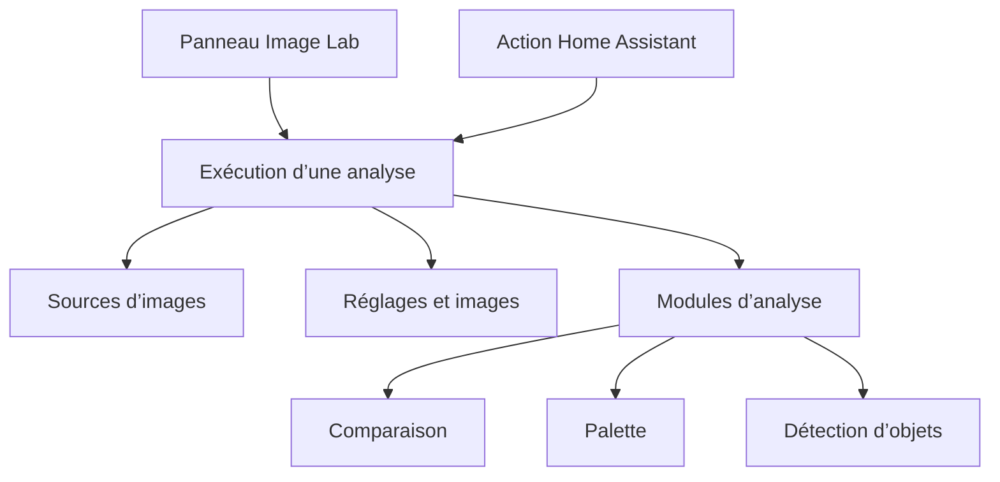

# Image Lab pour Home Assistant

Image Lab est une intégration Home Assistant pour comparer des images à des références, en extraire une palette de couleurs, détecter des objets et relever l’index de compteurs mécaniques. Une **analyse** associe une source, un type de traitement et des réglages. Elle se configure dans le panneau Image Lab et peut être lancée à la demande dans une automatisation. Les images sont traitées localement par Home Assistant.

## Installation via HACS

Prérequis · **Home Assistant Core 2026.10.4 ou ultérieur** et [HACS installé](https://www.hacs.dev/docs/use/download/download/).

1. Dans **HACS → ⋮ → Dépôts personnalisés**, ajouter `https://github.com/zoic21/ha-imagelab` dans la catégorie **Intégration**. Ouvrir **Image Lab**, sélectionner **Télécharger**, puis redémarrer Home Assistant.
2. Dans **Paramètres → Appareils et services → Ajouter une intégration**, ajouter **Image Lab**. Cette étape ouvre l’accès au panneau dans la barre latérale.
3. Ouvrir **Image Lab**, puis **Ajouter une analyse**. Choisir un nom, le type d’analyse et sa source. Pour une image importée, utiliser un JPEG, PNG ou WebP fixe de 10 Mio et 24 mégapixels maximum.

Le panneau et les appels manuels à l’action sont réservés aux administrateurs. Les captures et pochettes sont récupérées à chaque analyse. L’original d’une image importée est conservé dans le répertoire de configuration et supprimé avec l’analyse.

### Mise à jour et restauration

- Pour mettre à jour Image Lab, installer la version proposée par HACS et redémarrer Home Assistant. Les analyses, leurs identifiants, les réglages et les originaux restent dans le répertoire de configuration Home Assistant.
- Pour sauvegarder ou restaurer Image Lab, inclure **Home Assistant** dans la [sauvegarde Home Assistant](https://www.home-assistant.io/common-tasks/general/backups/). Cette partie contient les analyses et les images enregistrées. Après restauration, ouvrir le panneau et tester une analyse de comparaison et une analyse de palette.
- Sur iPad, ouvrir Image Lab avec un compte administrateur. Dans une analyse de comparaison, **Tester la source → Tracer la zone** permet de dessiner le rectangle au doigt. Dans **Réglages**, vérifier le rectangle et sélectionner **Enregistrer**.

## Outils disponibles

| Outil | Ce qu’on configure | Ce que l’analyse renvoie |
| --- | --- | --- |
| **Comparaison d’images** | Une source, une zone facultative, des états nommés et plusieurs images de référence par état | L’état reconnu ou `unknown`, les scores par état et la référence la plus proche |
| **Extraction de palette** | Une source et le nombre de couleurs demandé | Une couleur dominante et la palette RGB, utilisables dans une automatisation |
| **Détection d’objets** | Une capture caméra ou une image importée, des catégories et un seuil de confiance | La présence, le nombre par catégorie, le score et le rectangle de chaque objet détecté |
| **Lecture de compteur** | Une caméra fixe ou une image importée, le cadrage des rouleaux et aiguilles et un index initial confirmé | L’index, la confiance de lecture et le motif d’un éventuel rejet |

Exemples d’usage :

- Déterminer si un volet de piscine est ouvert, fermé ou intermédiaire à partir d’une capture caméra. Les références prises de jour et de nuit peuvent appartenir au même état.
- Extraire les couleurs de la pochette d’un lecteur multimédia et transmettre la palette à l’automatisation qui pilote les lumières.
- Vérifier la présence d’une personne, d’un chien ou d’un véhicule dans une capture prise au déclenchement d’une automatisation.

Les sources disponibles sont une **capture de caméra Home Assistant**, la **pochette d’un lecteur multimédia** ou une **image importée**. Le panneau propose les sources que l’outil sélectionné sait utiliser.

## Interface

Le tableau affiche le nom, le type, la source et le déclenchement de chaque analyse. La recherche et le tri portent sur ces quatre champs. Par défaut, les analyses qui demandent une intervention apparaissent en tête de liste. Cliquer sur une ligne ouvre sa fiche. L’onglet **Réglages** affiche les paramètres du type d’analyse, **Source et déclenchement** et **Entité de résultat**. Cliquer sur l’identifiant de l’entité ouvre sa fiche Home Assistant. L’identifiant de l’analyse se copie en bas de l’onglet. Le menu **⋮ → Renommer** permet de changer le nom. Dans **Source et déclenchement**, choisir **Modifier la source** pour sélectionner une autre caméra ou une autre image. Le type est fixé à la création. La comparaison dispose aussi de l’onglet **Références**. Les formulaires et sélecteurs sont ceux de Home Assistant.

**Résultat** affiche la dernière analyse manuelle ou automatique, avec l’image utilisée, le résultat et la date. Ouvrir la fiche ne déclenche aucune capture. Si l’analyse n’a encore jamais donné de résultat, sélectionner **Tester la source**. Ce bouton utilise les réglages enregistrés, ajoute la capture à l’historique et actualise l’entité configurée.

### Publier le résultat dans une entité

La publication dans Home Assistant se configure dans **Image Lab → Réglages → Entité de résultat**. Elle est facultative et s’active pour chaque analyse. Une première analyse initialise l’état de l’entité dès que la source est disponible au chargement. Un compteur restaure son dernier index validé au démarrage.

| Module | Entité disponible |
| --- | --- |
| Comparaison | Capteur à états nommés, ou capteur binaire avec classe et correspondances « activé » / « désactivé » |
| Détection d’objets | Occupation ou nombre d’objets parmi les catégories sélectionnées, au seuil de confiance du profil |
| Palette | Couleur dominante au format hexadécimal |
| Lecture de compteur | Index cumulé pour l’eau, le gaz ou l’électricité, activé à la création |

Pour suivre un volet, créer les états **Ouvert** et **Fermé** dans **Références**, y classer des captures de la caméra et régler les seuils dans **Réglages**. Dans les options, choisir **Capteur binaire → Ouverture**, associer **Ouvert** à « activé » et **Fermé** à « désactivé ». Une image ambiguë ou un troisième état donne `unknown`. Une caméra inaccessible donne `unavailable`. Les associations survivent au renommage d’un état.

Le capteur de palette expose toutes les couleurs dans les attributs `palette_hex` et `palette_rgb`. Les deux entités de détection d’objets exposent `objects` (catégorie, confiance et cadre normalisé pour chaque objet), `counts` (nombre par catégorie), `count` et `truncated`.

Une palette publiée par un lecteur multimédia se recalcule au changement de pochette. Les changements de position, de volume ou de lecture qui conservent la même pochette ne lancent pas d’analyse.

Dans la fiche de l’analyse, ouvrir **Réglages → Source et déclenchement**. Avec une caméra, saisir par exemple **5** dans **Intervalle (minutes)** puis sélectionner **Enregistrer la fréquence**. La fréquence s’applique aussi aux analyses qui ne publient aucune entité. Les profils caméra partagent une horloge commune. **0** lance les analyses à la demande. Une image importée est analysée à la demande. L’action `image_lab.analyze` actualise aussi l’entité de résultat.

Dans les options des profils caméra de comparaison, de palette et de détection, **Délai de confirmation d’un changement** accepte de 1 à 60 secondes (0 par défaut). Le premier état connu est publié immédiatement. Quand une analyse périodique, un test depuis le panneau ou l’action `image_lab.analyze` détecte ensuite un changement, Image Lab attend le délai choisi et prend une nouvelle photo. Deux valeurs identiques publient le nouvel état. Une seconde valeur différente ou indéterminée conserve l’état précédent jusqu’à la prochaine analyse. Une erreur de caméra rend l’entité indisponible.

L’action renvoie la dernière observation et, lorsqu’une seconde capture a été demandée, le champ `confirmation` vaut `confirmed`, `disagreed` ou `failed`. En comparaison planifiée, les deux prises de vue suivent les réglages de captures automatiques du profil.

### Suivre plusieurs zones sur une caméra

Créer une analyse par zone, choisir la même entité caméra et nommer chaque analyse selon ce qu’elle surveille. Par exemple, **Portillon** peut publier un capteur d’ouverture par comparaison et **Allée** le nombre de voitures par détection d’objets. Chaque profil garde ses réglages, son entité et sa fréquence.

Pour une comparaison, tracer le rectangle dans **Aperçu** puis l’enregistrer dans **Réglages**. Pour la palette et la détection, utiliser **Modifier la zone caméra**, tracer sur l’image entière ou saisir les coordonnées en pourcentage, puis enregistrer. **Tester la source** montre le résultat sur le cadrage choisi.

Quand plusieurs analyses automatiques de la même caméra arrivent à échéance ensemble, Home Assistant prend une seule image pour toutes ces zones. Avec des intervalles de 2 et 5 minutes, les deux zones partagent donc la capture toutes les 10 minutes. Un test ou une action manuelle demande sa propre capture.

### Revoir et corriger les captures

**Historique** regroupe les captures par jour et distingue les analyses manuelles des analyses automatiques. Chaque ligne affiche une vignette et le résultat principal. Toucher une ligne ouvre l’image avec le résultat détaillé, selon le type d’analyse.

Dans **Réglages → Historique**, choisir la limite d’images **de 1 à 100** (10 par défaut) et le mode de conservation. **Toutes les analyses** et **Désactivé** s’appliquent aux captures automatiques. La comparaison propose aussi **Changements et états indéterminés**. Les tests manuels comptent dans la limite. Le dernier résultat reste consultable quel que soit le mode choisi.

Dans le détail d’une comparaison, choisir l’état attendu puis **Ajouter comme référence**. La galerie conserve l’original après sa sortie de l’historique. La prédiction d’origine reste consultable tant que la capture figure dans l’historique.

### Comparer des images

1. Dans **Références**, créer un état par situation à reconnaître. Les états sont repliés à l’ouverture de la fiche. Déplier un état pour consulter ou importer ses images de référence. Les anciennes images de validation deviennent des références pour l’état auquel elles étaient associées.
2. **Résultat** affiche la dernière capture et sa référence la plus proche côte à côte, si la référence est disponible. **Tester la source** relance l’analyse. **Tracer la zone** permet de cadrer à la souris ou au doigt. **Ajouter comme référence** ajoute la capture affichée à l’état choisi.
3. Dans **Réglages**, ajuster la distance maximale (25 par défaut) et l’écart minimal (3 par défaut) sur une échelle de 0 à 255. La zone peut aussi être saisie en pourcentages. Enregistrer les réglages avant de relancer un test.

Dans **Réglages → Moteur de comparaison**, choisir **Pillow** ou **Tarsius (ncnn)**. **Enregistrer** applique le moteur aux tests, à l’action et aux analyses périodiques. Les profils existants utilisent Pillow par défaut.

Pillow mesure une distance (la plus petite gagne) et utilise les deux seuils du profil. Tarsius mesure une similarité (la plus grande gagne) avec son propre critère de décision. Il utilise la même zone et la même galerie, avec au moins deux états et une référence exploitable par état. Home Assistant installe Tarsius à sa première utilisation. Une analyse indécise donne `unknown`.

Les originaux sont conservés dans la configuration Home Assistant. Le cadrage s’applique à chaque image lors du calcul.

### Extraire une palette

1. Créer une analyse **Palette de couleurs** et choisir un lecteur multimédia, une caméra ou une image importée. Régler le nombre de couleurs de 1 à 10. Les analyses existantes utilisent cinq couleurs par défaut.
2. Dans Image Lab, choisir **Tester la source** pour afficher l’image analysée et les échantillons avec leurs codes hexadécimaux. Le premier échantillon indique la couleur dominante.
3. Pour modifier le nombre de couleurs, ouvrir **Réglages** dans la fiche de l’analyse.

### Détecter des objets

1. Créer une analyse **Détection d’objets** et choisir une caméra ou importer une image.
2. Sélectionner les catégories à rechercher ou laisser le champ vide pour utiliser les 80 catégories COCO. Le seuil de confiance est de 40 % par défaut.
3. Dans Image Lab, sélectionner **Tester la source** pour afficher les objets encadrés et leurs scores. Pour modifier les catégories ou le seuil, ouvrir **Réglages** dans la fiche de l’analyse.

NanoDet-Plus 416 × 416 s’exécute sur le CPU avec `ncnn`. La première analyse nécessite un accès à PyPI pour installer le moteur et à GitHub pour télécharger le modèle officiel de 2,2 Mo. Le modèle est vérifié et conservé dans la configuration Home Assistant. Les analyses suivantes utilisent ce modèle local et les images restent sur Home Assistant. [NanoDet-Plus](https://github.com/RangiLyu/nanodet) · [Modèle ncnn](https://github.com/RangiLyu/nanodet/releases/tag/v1.0.0-alpha-1)

### Lire un compteur mécanique

1. Créer une analyse **Lecture de compteur** avec une caméra fixe ou une image importée.
2. Dans **Réglages → Calibrer le compteur**, choisir l’eau, le gaz ou l’électricité. Utiliser **Rotation** pour mettre les chiffres à l’horizontale. Utiliser le zoom et le bouton **Déplacer l’image** pour voir le cadran de plus près. Tracer un rectangle serré autour de tous les rouleaux, puis indiquer le nombre total de rouleaux et le nombre de rouleaux décimaux.
3. Pour un compteur à rouleaux et aiguilles, ajouter un rectangle centré sur chaque aiguille, de la plus significative à la moins significative. Choisir le sens de rotation de chaque cadran.
4. Sélectionner **Tester** en bas de la fenêtre. Le résultat s’affiche au-dessus des boutons. Saisir l’index affiché sur le compteur et une hausse maximale réaliste par heure (m³/h ou kWh/h), puis enregistrer. La confirmation de l’index initialise le capteur.
5. Lancer **Tester la source** dans **Résultat** ou définir un intervalle pour la caméra. Le capteur d’index peut être sélectionné dans le tableau de bord Énergie de Home Assistant.

Le moteur local [Tarsius](https://github.com/RaHehl/tarsius), également utilisé par [Local Vision](https://github.com/RaHehl/local-vision), est installé lors du premier test. Une hausse incohérente, une baisse ou une lecture douteuse conserve le dernier index validé, y compris après un redémarrage. L’historique affiche la lecture et son éventuel motif de rejet. Recalibrer si la position de la caméra change. Utiliser une nouvelle analyse pour un nouveau compteur, une autre unité ou un autre nombre de chiffres avant la virgule.

## Architecture



Une intégration `custom_components/image_lab` regroupe le backend Python et le panneau TypeScript. Chaque analyse dispose d’un identifiant stable et d’une entrée de configuration Home Assistant avec sa source et ses options. Renommer l’analyse conserve son identifiant. Le panneau est enregistré une seule fois pour l’intégration.

| Partie | Responsabilité |
| --- | --- |
| **Sources** | Récupérer des octets d’image depuis une entité `camera`, un lecteur multimédia ou une image importée. Le module reçoit l’image et les informations nécessaires au cadrage. |
| **Exécution** | Charger les options, récupérer la source, appeler le module et formater sa réponse. Le traitement d’image s’exécute hors de la boucle principale de Home Assistant. |
| **Stockage** | Conserver les images originales et leurs métadonnées par analyse. Les coordonnées de la zone sont relatives à l’image pour supporter les changements de résolution. Versionner les données et permettre aux sauvegardes Home Assistant de reprendre les références. |
| **Modules** | Déclarer les sources prises en charge, le schéma des réglages et le format du résultat. Chaque module possède son moteur et son affichage spécifique. Le registre des modules est explicite dans le code. |
| **Panneau** | Lister les analyses, éditer la zone et gérer les références. Les commandes de configuration et de test passent par le backend Home Assistant. |

Le moteur de comparaison **Pillow** reprend le Pyscript. Il recadre, redimensionne, passe en niveaux de gris et applique un flou avant de mesurer la moyenne des écarts absolus entre les pixels. Il expose la distance au meilleur état et l’écart avec le suivant. Les seuils se règlent sur des captures représentatives, en testant la source sur de nouvelles captures. Les images originales sont conservées pour pouvoir recadrer les références après coup.

Le premier moteur de **palette** reprend l’extraction existante pour les pochettes et conserve un résultat `palette_rgb` de taille prévisible. Le nombre de couleurs distinctes peut être inférieur à la longueur demandée. La taille par défaut est de cinq entrées pour les automatisations existantes. Les couleurs disponibles sont réutilisées si nécessaire.

## Actions et résultats

L’action `image_lab.analyze` et le bouton **Tester la source** utilisent le même moteur. Le panneau fournit l’identifiant de l’analyse à copier dans l’automatisation. [Actions avec données de réponse](https://contributors.home-assistant.io/core/integrations/actions/#return-response-data)

Ce bloc utilise un identifiant d’exemple.

```yaml
action: image_lab.analyze
data:
  profile_id: "01jfxc7wcj5d1wzqjpgzrw2mgp"
response_variable: analysis
```

La réponse contient un `status` commun et un objet `data` propre au module. La comparaison indique le moteur utilisé dans `data.engine` et renvoie `data.state`, `data.scores`, `data.ref_counts`, l’écart entre les deux meilleurs états et l’identifiant de la référence la plus proche quand ils sont disponibles. Avec Pillow, `data.distance` est la meilleure distance. Avec Tarsius, `data.scores` contient les similarités et `data.distance` ne s’applique pas. Une distance trop élevée ou un écart insuffisant donnent `status: unknown` et `data.state: unknown`. Une source indisponible donne `status: error`. Le champ `reason` précise la cause. Un lecteur sans pochette renvoie `reason: source_no_image`.

La palette renvoie `data.dominant_rgb`, `data.dominant_hex`, `data.palette_rgb` et `data.palette_hex`. Les champs Pyscript `color1_rgb`, `color1` et les suivants restent disponibles dans `data`, jusqu’à la taille choisie. `data.extracted_count` compte les couleurs extraites avant répétition et `data.repeated_count` indique le nombre d’entrées ajoutées. Une image noire ou totalement transparente donne un gris clair de secours.

Dans une automatisation à cinq couleurs qui appelait le Pyscript, conserver la taille par défaut, remplacer l’appel par `image_lab.analyze` et lire `analysis.data.palette_rgb` après avoir vérifié `analysis.status == 'ok'`.

La détection d’objets renvoie `data.detected`, `data.count`, `data.counts` et `data.objects`. Chaque objet contient `label` (identifiant COCO, par exemple `person` ou `traffic_light`), `confidence` (de 0 à 1) et `box` (`x_min`, `y_min`, `x_max`, `y_max` entre 0 et 1, par rapport à l’image orientée). Une image sans détection donne `status: ok` et `data.count: 0`. La réponse contient au plus les 100 détections les plus fiables et indique `data.truncated: true` si cette limite est atteinte et d’autres objets ont été détectés.

Après l’appel à `image_lab.analyze`, cette condition vérifie la présence d’une personne.

```yaml
- condition: template
  value_template: "{{ analysis.status == 'ok' and analysis.data.counts.get('person', 0) > 0 }}"
```

## Plan de réalisation

| Étape | Travail | Critère de validation |
| --- | --- | --- |
| **1. Intégration et panneau** | Ajouter la création d’analyses, le stockage, les sources d’image, le registre de modules et l’action. Réutiliser le thème et les formulaires natifs. | Créer une analyse depuis Home Assistant, la retrouver après redémarrage et récupérer la même source depuis le panneau et l’action. |
| **2. Comparaison** | Porter le comparateur Pyscript. Ajouter le cadrage tactile, la galerie par état, l’import multiple, le reclassement et les deux seuils. | Rejouer des captures de jour et de nuit avec des images gardées pour le test. Vérifier au moins trois états, un cas ambigu et une caméra indisponible. |
| **3. Palette** | Porter l’extraction couleur. Afficher l’aperçu des couleurs et exposer le résultat RGB aux automatisations. | Récupérer les palettes de deux lecteurs, vérifier le comportement en l’absence de pochette et rejouer une automatisation existante à cinq couleurs. |
| **4. Première version installable** | Vérifier l’installation via HACS sur une instance Home Assistant OS, l’éditeur tactile, les sauvegardes et la restauration. | Réussir une installation propre et une mise à jour avec conservation des analyses et références. Documenter le premier parcours complet. |

La plateforme de validation de la première version est **Home Assistant OS x86‑64**. [Structure d’une intégration HACS](https://hacs.dev/docs/publish/integration/)

## Évolutions possibles

| Évolution | Approche |
| --- | --- |
| **Reconnaissance d’un objet précis** | Recadrer l’objet détecté, puis comparer ce recadrage à plusieurs exemples annotés sous des angles différents. Évaluer les faux positifs sur des objets similaires et prévoir une identité inconnue. |
| **Comparaison plus robuste** | Évaluer les deux moteurs sur davantage de captures de jour, de nuit et de scènes ambiguës pour guider le choix par profil. |
| **Nouveaux outils** | Envisager des outils comme la présence d’une couleur dans une zone ou l’OCR d’un affichage. Chaque outil réutilise la capture, les réglages communs et l’action. |

### Validation déjà réalisée pour la détection

Un prototype NanoDet-Plus 416 × 416 a fonctionné dans l’image officielle de **Core 2026.10.4 x86‑64**, sur CPU, avec `ncnn` et sans OpenCV. Le modèle converti pèse **2,42 Mo**. Une action Home Assistant a récupéré un JPEG via une caméra alimentée par un fichier de test et renvoyé les détections. Sur un AMD EPYC, la médiane de 30 analyses était de **26,5 ms** sur un thread, décodage et traitement des résultats compris.

La mesure sur Intel N100 et la validation sur des captures de jour et de nuit restent à faire. [Paquet Python ncnn](https://pypi.org/project/ncnn/)

## Développer le panneau

Le navigateur charge le module compilé livré avec l’intégration. Après avoir modifié les sources TypeScript dans `frontend`, reconstruire le fichier JavaScript avec la commande suivante.

```sh
npx --yes --package typescript@6.0.3 tsc -p frontend
```

## Publier une version

Mettre à jour `version` dans `custom_components/image_lab/manifest.json`. Après fusion sur `main`, ouvrir **Actions → Validate integration → Run workflow**, choisir `main` et activer **Publish the version declared in manifest.json**. Après les deux validations, GitHub crée la release et le tag au numéro du manifeste. HACS récupère le répertoire de l’intégration depuis ce tag.
