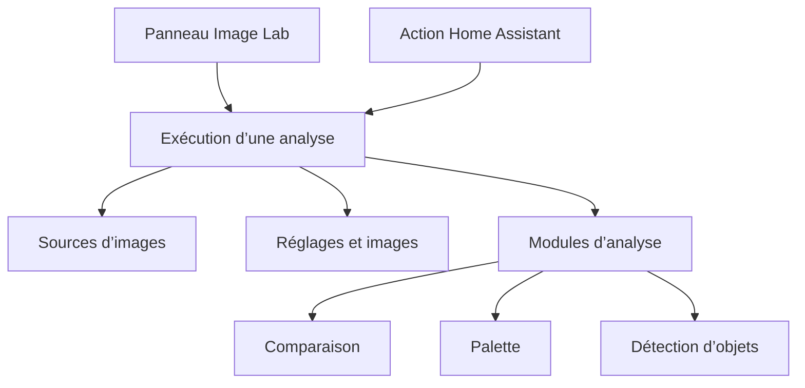

# Image Lab pour Home Assistant

Image Lab est une intégration Home Assistant pour comparer des images à des références, en extraire une palette de couleurs et détecter des objets. Une **analyse** associe une source, un type de traitement et des réglages. Elle se configure dans le panneau Image Lab et peut être lancée à la demande dans une automatisation. Les images sont traitées localement par Home Assistant.

## Installation via HACS

Prérequis · **Home Assistant Core 2026.10.4 ou ultérieur** et [HACS installé](https://www.hacs.dev/docs/use/download/download/).

1. Dans **HACS → ⋮ → Dépôts personnalisés**, ajouter `https://github.com/zoic21/ha-imagelab` dans la catégorie **Intégration**. Ouvrir **Image Lab**, sélectionner **Télécharger**, puis redémarrer Home Assistant.
2. Dans **Paramètres → Appareils et services → Ajouter une intégration**, chercher **Image Lab**. Saisir le nom et choisir le module puis la source. Pour une image importée, sélectionner un JPEG, PNG ou WebP fixe de 10 Mio et 24 mégapixels maximum.
3. Ouvrir **Image Lab** dans la barre latérale et sélectionner l’analyse. Le panneau permet également d’ajouter d’autres analyses et de les reconfigurer dans les réglages natifs de l’intégration.

Le panneau et les appels manuels à l’action sont réservés aux administrateurs. Les captures et pochettes sont récupérées à chaque analyse. L’original d’une image importée est conservé dans le répertoire de configuration et supprimé avec l’analyse.

### Mise à jour et restauration

- Pour mettre à jour Image Lab, installer la version proposée par HACS et redémarrer Home Assistant. Les analyses, leurs identifiants, les réglages et les originaux restent dans le répertoire de configuration Home Assistant.
- Pour sauvegarder ou restaurer Image Lab, inclure **Home Assistant** dans la [sauvegarde Home Assistant](https://www.home-assistant.io/common-tasks/general/backups/). Cette partie contient les analyses et les images enregistrées. Après restauration, ouvrir le panneau et tester une analyse de comparaison et une analyse de palette.
- Sur iPad, ouvrir Image Lab avec un compte administrateur. Dans une analyse de comparaison, **Tester la source → Tracer la zone** permet de dessiner le rectangle au doigt. Dans **Réglages**, vérifier le rectangle et sélectionner **Enregistrer**.

## Outils disponibles

| Outil | Ce qu’on configure | Ce que l’analyse renvoie |
| --- | --- | --- |
| **Comparaison d’images** | Une source, une zone facultative, des états nommés et plusieurs images de référence par état | L’état reconnu ou `unknown`, les distances par état et la référence la plus proche |
| **Extraction de palette** | Une source et le nombre de couleurs demandé | Une couleur dominante et la palette RGB, utilisables dans une automatisation |
| **Détection d’objets** | Une capture caméra ou une image importée, des catégories et un seuil de confiance | La présence, le nombre par catégorie, le score et le rectangle de chaque objet détecté |

Exemples d’usage :

- Déterminer si un volet de piscine est ouvert, fermé ou intermédiaire à partir d’une capture caméra. Les références prises de jour et de nuit peuvent appartenir au même état.
- Extraire les couleurs de la pochette d’un lecteur multimédia et transmettre la palette à l’automatisation qui pilote les lumières.
- Vérifier la présence d’une personne, d’un chien ou d’un véhicule dans une capture prise au déclenchement d’une automatisation.

Les sources disponibles sont une **capture de caméra Home Assistant**, la **pochette d’un lecteur multimédia** ou une **image importée**. Le panneau propose les sources que l’outil sélectionné sait utiliser.

## Interface

Sur tablette en paysage et sur ordinateur, le panneau affiche la liste et le détail côte à côte. Sur mobile, le détail s’ouvre sur toute la largeur. La création et la reconfiguration des analyses utilisent les formulaires et sélecteurs natifs de Home Assistant.

### Publier le résultat dans une entité

Dans Image Lab, ouvrir le profil puis **Configurer l’analyse**. Dans la fiche de l’intégration, cliquer sur **Configurer** (roue dentée) sur la ligne surlignée, puis choisir l’entité de résultat. Par défaut, les profils fonctionnent à la demande sans créer d’entité.

| Module | Entité disponible |
| --- | --- |
| Comparaison | Capteur à états nommés, ou capteur binaire avec classe et correspondances « activé » / « désactivé » |
| Détection d’objets | Occupation ou nombre d’objets parmi les catégories sélectionnées, au seuil de confiance du profil |
| Palette | Couleur dominante au format hexadécimal |

Pour suivre un volet, créer les états **Ouvert** et **Fermé** dans **Références**, y classer des captures de la caméra et régler les seuils dans **Réglages**. Dans les options, choisir **Capteur binaire → Ouverture**, associer **Ouvert** à « activé » et **Fermé** à « désactivé ». Une image ambiguë ou un troisième état donne `unknown`. Une caméra inaccessible donne `unavailable`. Les associations survivent au renommage d’un état.

Avec une caméra, indiquer par exemple **5 minutes** pour une actualisation périodique côté Home Assistant. La première capture automatique a lieu à la fin de cet intervalle. **0** conserve le fonctionnement manuel. L’action `image_lab.analyze` actualise aussi l’entité. Les aperçus, essais de cadrage et images de validation servent uniquement au réglage. Le panneau affiche le lien vers l’entité créée.

### Comparer des images

1. Dans **Références**, créer un état par situation à reconnaître. Importer plusieurs images à la fois dans **Images de référence**. Garder d’autres captures dans **Images de validation**, avec leur état attendu. Le bouton **Évaluer** rejoue ces captures sans les utiliser comme références.
2. Dans **Aperçu**, sélectionner **Tester la source**. Choisir **Tracer la zone** pour cadrer à la souris ou au doigt. Le panneau montre l’état proposé, les distances par état et la référence la plus proche. **Classer la capture** ajoute l’image testée à l’état et au groupe choisis.
3. Dans **Réglages**, ajuster la distance maximale (25 par défaut) et l’écart minimal (3 par défaut) sur une échelle de 0 à 255. La zone peut aussi être saisie en pourcentages. Les tests peuvent utiliser les réglages en cours d’édition. L’action utilise les réglages enregistrés.

Dans **Références → Comparer Pillow et Tarsius**, les deux moteurs évaluent les mêmes images de validation avec la même zone. Prévois au moins deux états avec une référence utilisable par état. Le tableau indique le nombre de résultats corrects, erronés, indéterminés ou en erreur et le temps de traitement médian sur la machine Home Assistant, après préparation des références. Le détail montre l’état attendu et le résultat de chaque moteur par image. Pour comparer les conditions, utilise des noms explicites comme `ferme-jour`, `ferme-infrarouge` ou `ferme-reflets`.

Les seuils de distance et d’écart s’appliquent au moteur Pillow. Tarsius (ncnn) utilise ses propres critères et Home Assistant installe la bibliothèque au premier lancement du comparatif.

Pour migrer les références Pyscript, choisir **Importer les dossiers par état** dans un navigateur qui prend en charge la sélection de dossiers. Sélectionner le dossier `references` qui contient un sous-dossier par état. Les images sont importées comme références et les états correspondants sont créés. Les originaux sont conservés dans la configuration Home Assistant. Le cadrage s’applique à chaque image lors du calcul.

### Extraire une palette

1. Créer une analyse **Palette de couleurs** et choisir un lecteur multimédia, une caméra ou une image importée. Régler le nombre de couleurs de 1 à 10. Les analyses existantes utilisent cinq couleurs par défaut.
2. Dans Image Lab, choisir **Tester la source** pour afficher l’image analysée et les échantillons avec leurs codes hexadécimaux. Le premier échantillon indique la couleur dominante.
3. Pour modifier le nombre de couleurs, ouvrir **Configurer l’analyse** et reconfigurer l’analyse.

### Détecter des objets

1. Créer une analyse **Détection d’objets** et choisir une caméra ou importer une image.
2. Sélectionner les catégories à rechercher ou laisser le champ vide pour utiliser les 80 catégories COCO. Le seuil de confiance est de 40 % par défaut.
3. Dans Image Lab, sélectionner **Tester la source** pour afficher les objets encadrés et leurs scores. Pour modifier les catégories ou le seuil, ouvrir **Configurer l’analyse** et reconfigurer l’analyse.

NanoDet-Plus 416 × 416 s’exécute sur le CPU avec `ncnn`. La première analyse nécessite un accès à PyPI pour installer le moteur et à GitHub pour télécharger le modèle officiel de 2,2 Mo. Le modèle est vérifié et conservé dans la configuration Home Assistant. Les analyses suivantes utilisent ce modèle local et les images restent sur Home Assistant. [NanoDet-Plus](https://github.com/RangiLyu/nanodet) · [Modèle ncnn](https://github.com/RangiLyu/nanodet/releases/tag/v1.0.0-alpha-1)

## Architecture



Une intégration `custom_components/image_lab` regroupe le backend Python et le panneau TypeScript. Chaque analyse dispose d’un identifiant stable et d’une entrée de configuration Home Assistant avec sa source et ses options. Renommer l’analyse conserve son identifiant. Le panneau est enregistré une seule fois pour l’intégration.

| Partie | Responsabilité |
| --- | --- |
| **Sources** | Récupérer des octets d’image depuis une entité `camera`, un lecteur multimédia ou une image importée. Le module reçoit l’image et les informations nécessaires au cadrage. |
| **Exécution** | Charger les options, récupérer la source, appeler le module et formater sa réponse. Le traitement d’image s’exécute hors de la boucle principale de Home Assistant. |
| **Stockage** | Conserver les images originales et leurs métadonnées par analyse. Les coordonnées de la zone sont relatives à l’image pour supporter les changements de résolution. Versionner les données et permettre aux sauvegardes Home Assistant de reprendre les références. |
| **Modules** | Déclarer les sources prises en charge, le schéma des réglages et le format du résultat. Chaque module possède son moteur et son affichage spécifique. Le registre des modules est explicite dans le code. |
| **Panneau** | Lister les analyses, éditer la zone et gérer les références. Les commandes de configuration et de test passent par le backend Home Assistant. |

Le moteur de **comparaison** reprend le Pyscript. Il recadre, redimensionne, passe en niveaux de gris et applique un flou avant de mesurer la moyenne des écarts absolus entre les pixels. Il expose la distance au meilleur état et l’écart avec le suivant. Les seuils se règlent sur des captures représentatives, en gardant des images de test hors des références. Les images originales sont conservées pour pouvoir recadrer les références après coup.

Le premier moteur de **palette** reprend l’extraction existante pour les pochettes et conserve un résultat `palette_rgb` de taille prévisible. Le nombre de couleurs distinctes peut être inférieur à la longueur demandée. La taille par défaut est de cinq entrées pour les automatisations existantes. Les couleurs disponibles sont réutilisées si nécessaire.

## Actions et résultats

L’action `image_lab.analyze` et le bouton **Tester la source** utilisent le même moteur. Le panneau fournit l’identifiant de l’analyse à copier dans l’automatisation. [Actions avec données de réponse](https://contributors.home-assistant.io/core/integrations/actions/#return-response-data)

Ce bloc utilise un identifiant d’exemple.

```yaml
action: image_lab.analyze
data:
  profile_id: "01jfxc7wcj5d1wzqjpgzrw2mgp"
response_variable: analysis
```

La réponse contient un `status` commun et un objet `data` propre au module. La comparaison renvoie `data.state`, `data.scores`, `data.ref_counts`, la meilleure distance, l’écart et l’identifiant de la référence la plus proche. Une distance trop élevée ou un écart insuffisant donnent `status: unknown` et `data.state: unknown`. Une source indisponible donne `status: error`. Le champ `reason` précise la cause. Un lecteur sans pochette renvoie `reason: source_no_image`.

La palette renvoie `data.dominant_rgb`, `data.dominant_hex`, `data.palette_rgb` et `data.palette_hex`. Les champs Pyscript `color1_rgb`, `color1` et les suivants restent disponibles dans `data`, jusqu’à la taille choisie. `data.extracted_count` compte les couleurs extraites avant répétition et `data.repeated_count` indique le nombre d’entrées ajoutées. Une image noire ou totalement transparente donne un gris clair de secours.

Dans une automatisation à cinq couleurs qui appelait le Pyscript, conserver la taille par défaut, remplacer l’appel par `image_lab.analyze` et lire `analysis.data.palette_rgb` après avoir vérifié `analysis.status == 'ok'`.

La détection d’objets renvoie `data.detected`, `data.count`, `data.counts` et `data.objects`. Chaque objet contient `label` (identifiant COCO, par exemple `person` ou `traffic_light`), `confidence` (de 0 à 1) et `box` (`x_min`, `y_min`, `x_max`, `y_max` entre 0 et 1, par rapport à l’image orientée). Une image sans détection donne `status: ok` et `data.count: 0`. La réponse contient au plus les 100 détections les plus fiables et indique `data.truncated: true` si cette limite est atteinte et d’autres objets ont été détectés.

Après l’appel à `image_lab.analyze`, cette condition vérifie la présence d’une personne.

```yaml
- condition: template
  value_template: "{{ analysis.status == 'ok' and analysis.data.counts.get('person', 0) > 0 }}"
```

## Plan de réalisation

| Étape | Travail | Critère de validation |
| --- | --- | --- |
| **1. Intégration et panneau** | Ajouter la création d’analyses, le stockage, les sources d’image, le registre de modules et l’action. Réutiliser le thème et les formulaires natifs. | Créer une analyse depuis Home Assistant, la retrouver après redémarrage et récupérer la même source depuis le panneau et l’action. |
| **2. Comparaison** | Porter le comparateur Pyscript. Ajouter le cadrage tactile, la galerie par état, l’import multiple, le reclassement et les deux seuils. | Rejouer des captures de jour et de nuit avec des images gardées pour le test. Vérifier au moins trois états, un cas ambigu et une caméra indisponible. |
| **3. Palette** | Porter l’extraction couleur. Afficher l’aperçu des couleurs et exposer le résultat RGB aux automatisations. | Récupérer les palettes de deux lecteurs, vérifier le comportement en l’absence de pochette et rejouer une automatisation existante à cinq couleurs. |
| **4. Première version installable** | Vérifier l’installation via HACS sur une instance Home Assistant OS, l’éditeur tactile, les sauvegardes et la restauration. | Réussir une installation propre et une mise à jour avec conservation des analyses et références. Documenter le premier parcours complet. |

La plateforme de validation de la première version est **Home Assistant OS x86‑64**. [Structure d’une intégration HACS](https://hacs.dev/docs/publish/integration/)

## Évolutions possibles

| Évolution | Approche |
| --- | --- |
| **Lecture de compteurs mécaniques** | Évaluer `tarsius` pour lire les rouleaux et aiguilles. L’éditeur définit les zones et la rotation. Le module conserve la dernière lecture acceptée et contrôle la cohérence des nouvelles valeurs avant de publier un capteur Énergie. Un test de réglage ne valide pas une nouvelle valeur. |
| **Reconnaissance d’un objet précis** | Recadrer l’objet détecté, puis comparer ce recadrage à plusieurs exemples annotés sous des angles différents. Évaluer les faux positifs sur des objets similaires et prévoir une identité inconnue. |
| **Comparaison plus robuste** | Utiliser le comparatif Pillow/Tarsius avec des captures de jour, de nuit et des scènes ambiguës pour mesurer les erreurs et la latence avant de choisir un moteur par défaut. |
| **Nouveaux outils** | Envisager des outils comme la présence d’une couleur dans une zone ou l’OCR d’un affichage. Chaque outil réutilise la capture, les réglages communs et l’action. |

### Validation déjà réalisée pour la détection

Un prototype NanoDet-Plus 416 × 416 a fonctionné dans l’image officielle de **Core 2026.10.4 x86‑64**, sur CPU, avec `ncnn` et sans OpenCV. Le modèle converti pèse **2,42 Mo**. Une action Home Assistant a récupéré un JPEG via une caméra alimentée par un fichier de test et renvoyé les détections. Sur un AMD EPYC, la médiane de 30 analyses était de **26,5 ms** sur un thread, décodage et traitement des résultats compris.

La mesure sur Intel N100 et la validation sur des captures de jour et de nuit restent à faire. [Paquet Python ncnn](https://pypi.org/project/ncnn/)

## Développer le panneau

Le navigateur charge le module compilé livré avec l’intégration. Après avoir modifié les sources TypeScript dans `frontend`, reconstruire le fichier JavaScript avec la commande suivante.

```sh
npx --yes --package typescript@6.0.3 tsc -p frontend
```

## Publier une version

Mettre à jour `version` dans `custom_components/image_lab/manifest.json`. Après fusion sur `main`, ouvrir **Actions → Validate integration → Run workflow**, choisir `main` et activer **Publish the version declared in manifest.json**. Après les deux validations, GitHub crée la release et le tag au numéro du manifeste. HACS récupère le répertoire de l’intégration depuis ce tag.
